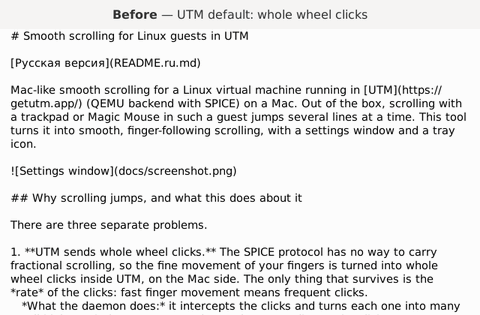
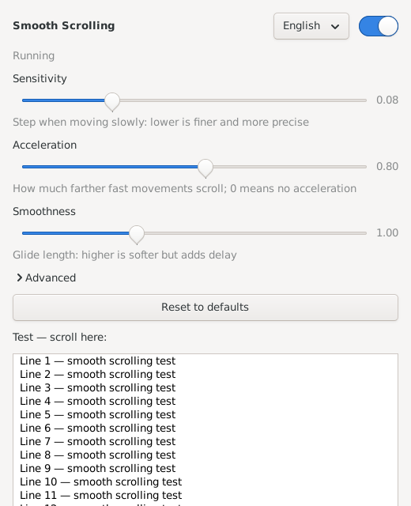

# Smooth scrolling for Linux guests in UTM

[Русская версия](README.ru.md)

Mac-like smooth scrolling for a Linux virtual machine running in [UTM](https://getutm.app/) (QEMU backend with SPICE) on a Mac. Out of the box, scrolling with a trackpad or Magic Mouse in such a guest jumps several lines at a time. This tool turns it into smooth, finger-following scrolling, with a settings window and a tray icon.



*The same recorded trackpad gestures, replayed without the tool (whole wheel clicks) and with it.*



## Why scrolling jumps, and what this does about it

There are three separate problems.

1. **UTM sends whole wheel clicks.** The SPICE protocol has no way to carry fractional scrolling, so the fine movement of your fingers is turned into whole wheel clicks inside UTM, on the Mac side. The only thing that survives is the *rate* of the clicks: fast finger movement means frequent clicks.
   *What the daemon does:* it intercepts the clicks and turns each one into many small high-resolution steps, spread over time according to the click rate. Fast swipes scroll faster, slow movement scrolls slowly and finely. A short burst of clicks at the start of a movement does not count as speed.

2. **libinput holds back the start of every gesture.** In libinput 1.28 a high-resolution wheel accumulates 60 units (half a click) at the start of *every* gesture and then emits them at once. So smoothed scrolling first waits, then jumps about three lines. There is no option to turn this off.
   *What the daemon does:* vertical scrolling is emitted through a separate virtual device in libinput's "button scrolling" mode. That mode only swallows its small start threshold instead of releasing it all at once, and the daemon spends that threshold invisibly.

3. **Firefox ignores smooth scrolling on X11 by default** and scrolls by whole clicks.
   *Fix:* start Firefox with `MOZ_USE_XINPUT2=1` (see [Tips](#tips)).

## Requirements

- A Linux guest in UTM with the **QEMU** backend and the **SPICE guest agent** (`spice-vdagent`). Scrolling must arrive through the `spice vdagent tablet` device.
- An **X11** session with the libinput driver (`xserver-xorg-input-libinput`). Wayland is not supported.
- `python3-evdev`, `python3-gi` with GTK 3, `xinput`. The installer installs any that are missing via `apt`.

Tested on Debian 13 (arm64) with XFCE, libinput 1.28, UTM on macOS, with both a trackpad and a mouse.

## Installation

```sh
git clone https://github.com/vladsboev-web/utm-linux-smooth-scroll.git
cd utm-linux-smooth-scroll
bash install.sh
```

Run it as your normal user; it asks for the sudo password. It installs:

| What | Where |
|---|---|
| Daemon (root, systemd service `smooth-scroll`) | `/usr/local/bin/smooth-scroll.py` |
| Settings window and tray icon | `/usr/local/bin/smooth-scroll-settings` |
| udev rule (resolution of the scroll device) | `/etc/udev/rules.d/99-smooth-scroll.rules` |
| X config ("button scrolling" mode) | `/etc/X11/xorg.conf.d/50-smooth-scroll.conf` |
| Menu entry and tray autostart | `~/.local/share/applications/`, `~/.config/autostart/` |

The X config takes effect at your next login. Until then the tray icon applies the same settings to the device itself.

## Settings

Click the tray icon, or open **Settings → Smooth Scrolling** from the applications menu. Changes apply immediately, with no restart.

- **Sensitivity** — the step when moving slowly. Lower is finer.
- **Acceleration** — how much farther fast movements scroll. 0 turns it off.
- **Smoothness** — glide length. Higher is softer but adds delay.
- **Advanced** — acceleration threshold, limit and ramp-up, the first-click glide, buffer delays, and natural (Mac-like) scrolling direction.
- An on/off switch, a language selector (English / Russian), and a test area to try scrolling right there.

Settings are stored in `~/.config/smooth-scroll/config.json`. When the switch is off, the daemon releases the device and scrolling works as if the tool were not installed.

## Tips

- **Firefox:** add `export MOZ_USE_XINPUT2=1` to `~/.xsessionrc` and log in again. Without it, Firefox gets only whole clicks.
- **"Captured" mouse mode in UTM:** scrolling may stop working there because UTM leaves Ctrl+Alt held down in the guest. Press and release Ctrl, then Alt. This mode goes through a different device and is not smoothed.
- **Long finger travel before scrolling starts:** UTM only sends a click after enough finger movement. Raising the scrolling speed in macOS settings makes clicks arrive sooner; then lower **Sensitivity** to compensate.

## How it works

The daemon grabs `spice vdagent tablet` and passes everything except the wheel to a clone device (`smooth scroll tablet`). Each wheel click becomes a target: an interpolation buffer moves toward it at the current click rate, with a small delay that adapts to that rate (longer while moving slowly, so scrolling does not stop between sparse clicks). The output goes to a second device (`smooth scroll wheel`) as relative movement with a held button, at 1/120 of a click per unit.

To log raw clicks and output for tuning, set `Environment=SMOOTH_DEBUG=/var/tmp/smooth-debug.log` in a drop-in for the service.

## Uninstall

```sh
bash uninstall.sh
```

## License

[MIT](LICENSE)
