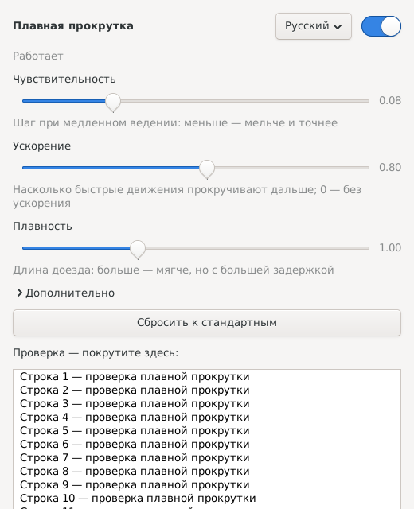

# Плавная прокрутка для Linux в UTM

[English version](README.md)

Плавная прокрутка как на маке для виртуалки с Linux в [UTM](https://getutm.app/) (бэкенд QEMU со SPICE) на маке. Без неё прокрутка трекпадом или Magic Mouse в такой виртуалке прыгает по несколько строк. Эта программа делает её плавной, идущей за пальцем, и даёт окно настроек и значок в трее.



## Почему прокрутка прыгает и что с этим делает программа

Здесь три отдельные проблемы.

1. **UTM передаёт целые щелчки колеса.** Протокол SPICE не умеет передавать дробную прокрутку, поэтому точное движение пальцев превращается в целые щелчки ещё внутри UTM, на маке. Сохраняется только *темп* щелчков: быстрое движение пальца — частые щелчки.
   *Что делает демон:* перехватывает щелчки и раскладывает каждый на много мелких шагов высокого разрешения, распределяя их по времени в темпе щелчков. Быстрый свайп прокручивает быстрее, медленное ведение — медленно и мелко. Короткая пачка щелчков в начале движения за скорость не считается.

2. **libinput придерживает начало каждого жеста.** В libinput 1.28 колесо высокого разрешения в начале *каждого* жеста копит 60 единиц (пол-щелчка) и выдаёт их разом. Поэтому сглаженная прокрутка сначала ждёт, а потом прыгает примерно на три строки. Выключить это настройкой нельзя.
   *Что делает демон:* вертикальная прокрутка выдаётся через отдельное виртуальное устройство в режиме libinput «прокрутка с кнопкой». В этом режиме небольшой стартовый порог только съедается, а не выдаётся разом, и демон тратит его незаметно.

3. **Firefox на X11 по умолчанию не берёт плавную прокрутку** и крутит целыми щелчками.
   *Решение:* запускать Firefox с `MOZ_USE_XINPUT2=1` (см. [Советы](#советы)).

## Требования

- Linux в UTM с бэкендом **QEMU** и **гостевым агентом SPICE** (`spice-vdagent`). Прокрутка должна приходить через устройство `spice vdagent tablet`.
- Сеанс **X11** с драйвером libinput (`xserver-xorg-input-libinput`). Wayland не поддерживается.
- `python3-evdev`, `python3-gi` с GTK 3, `xinput`. Недостающее установщик поставит сам через `apt`.

Проверено на Debian 13 (arm64) с XFCE, libinput 1.28, UTM на macOS, с трекпадом и с мышью.

## Установка

```sh
git clone https://github.com/vladsboev-web/utm-linux-smooth-scroll.git
cd utm-linux-smooth-scroll
bash install.sh
```

Запускать от своего обычного пользователя, установщик спросит пароль sudo. Что он ставит:

| Что | Куда |
|---|---|
| Демон (от root, служба systemd `smooth-scroll`) | `/usr/local/bin/smooth-scroll.py` |
| Окно настроек и значок в трее | `/usr/local/bin/smooth-scroll-settings` |
| Правило udev (разрешение устройства прокрутки) | `/etc/udev/rules.d/99-smooth-scroll.rules` |
| Настройка X (режим «прокрутка с кнопкой») | `/etc/X11/xorg.conf.d/50-smooth-scroll.conf` |
| Пункт меню и автозапуск значка | `~/.local/share/applications/`, `~/.config/autostart/` |

Настройка X заработает при следующем входе в сеанс. До этого те же параметры выставляет устройству значок в трее.

## Настройки

Щёлкните по значку в трее или откройте **Настройки → Плавная прокрутка** в меню приложений. Изменения применяются сразу, без перезапуска.

- **Чувствительность** — шаг при медленном ведении. Меньше — мельче.
- **Ускорение** — насколько дальше прокручивают быстрые движения. 0 — выключено.
- **Плавность** — длина доезда. Больше — мягче, но с большей задержкой.
- **Дополнительно** — порог, потолок и нарастание ускорения, доезд первого щелчка, задержки буфера, естественное направление (как на маке).
- Выключатель, выбор языка (English / Русский) и полоса для проверки прокрутки прямо в окне.

Настройки хранятся в `~/.config/smooth-scroll/config.json`. Если выключить, демон отпускает устройство, и прокрутка работает так, будто программы нет.

## Советы

- **Firefox:** добавьте `export MOZ_USE_XINPUT2=1` в `~/.xsessionrc` и перезайдите в сеанс. Без этого Firefox получает только целые щелчки.
- **Режим «захваченной» мыши в UTM:** прокрутка в нём может не работать, потому что UTM оставляет в виртуалке зажатыми Ctrl+Alt. Нажмите и отпустите Ctrl, потом Alt. Этот режим идёт через другое устройство, сглаживания в нём нет.
- **Долгий ход пальца до начала прокрутки:** UTM шлёт щелчок только после достаточного движения пальца. Если прибавить скорость прокрутки в настройках macOS, щелчки начнут приходить раньше; тогда уменьшите **Чувствительность**.

## Как это устроено

Демон перехватывает `spice vdagent tablet` и пропускает всё, кроме колеса, на устройство-клон (`smooth scroll tablet`). Каждый щелчок колеса становится целью: буфер интерполяции едет к ней в текущем темпе щелчков, с небольшой задержкой, которая подстраивается под этот темп (больше при медленном ведении, чтобы прокрутка не останавливалась между редкими щелчками). Результат идёт на второе устройство (`smooth scroll wheel`) как относительное движение с зажатой кнопкой, 1/120 щелчка на единицу.

Чтобы записывать сырые щелчки и выдачу для подстройки, задайте `Environment=SMOOTH_DEBUG=/var/tmp/smooth-debug.log` в дополнении (drop-in) к службе.

## Удаление

```sh
bash uninstall.sh
```

## Лицензия

[MIT](LICENSE)
